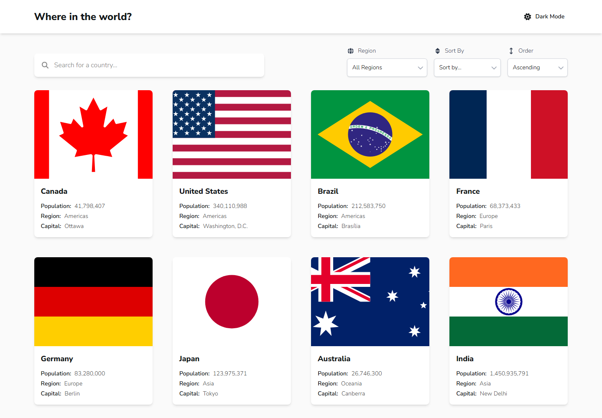
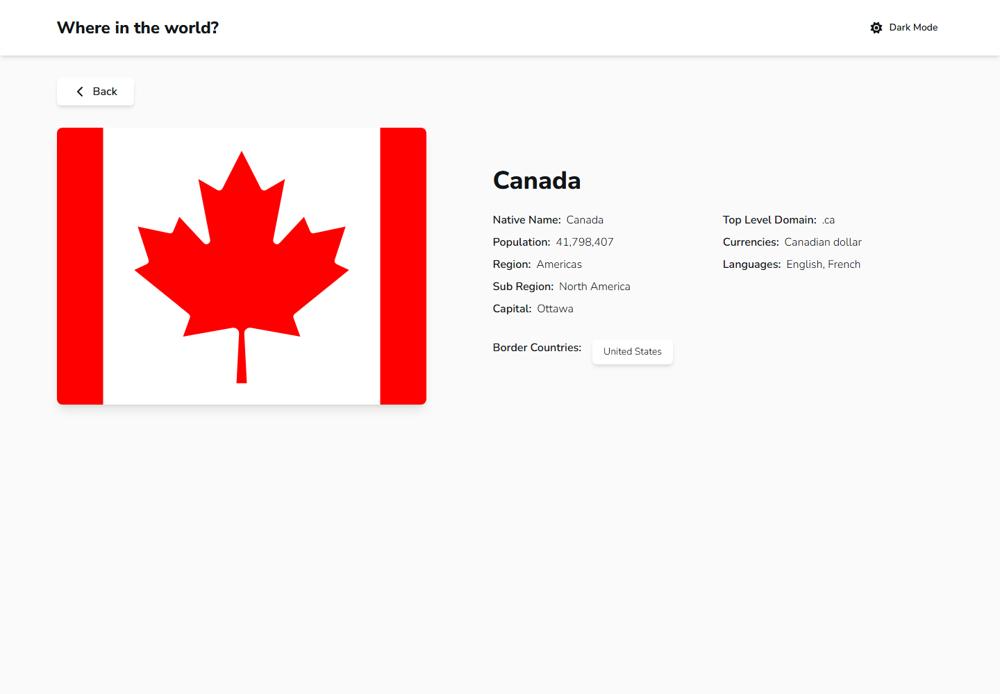

# Countries Explorer

A responsive country directory built with Vue 3 and TypeScript. Browse country details, search by name, filter by region, and sort the results. The interface includes dark mode and keeps filters in the URL.

## Preview

| Country directory                                    | Country details                                         |
| ---------------------------------------------------- | ------------------------------------------------------- |
|  |  |

## Stack

Vue 3, TypeScript, Vite, Tailwind CSS, Pinia, Vue Router, TanStack Vue Query, and the [REST Countries API](https://restcountries.com/).

## Run locally

```sh
npm ci
cp .env.example .env
npm run dev
```

The app uses REST Countries API v5 through a small proxy, keeping the API key out of the browser bundle. Create a key at [restcountries.com](https://restcountries.com/sign-up), copy `.env.example` to `.env`, and replace the placeholder value. `REST_COUNTRIES_API_KEY` is server-side configuration. `VITE_API_BASE_URL` is public and must never contain a secret. A real API key is required; without one, the API request will fail instead of quietly showing demo data.

Useful checks:

```sh
npm run type-check
npm run lint
npm run test:unit -- --run
npm run build
```

## Deploy on Netlify

Netlify is the shared frontend host for this project and the Vue CRUD demo. It assigns a `netlify.app` address and deploys each project from its Git repository. The CRUD app can keep Neon for its database if it needs PostgreSQL; Neon is a database service, while Netlify hosts the frontend.

1. Push the project to GitHub.
2. Sign in to [Netlify](https://app.netlify.com/) and choose **Add new project → Import an existing project**.
3. Connect GitHub and select this repository.
4. Confirm the build settings: command `npm run build`, publish directory `dist`. The included `netlify.toml` already sets these values and configures Vue Router fallback for direct links to country pages.
5. In **Project configuration → Environment variables**, add `REST_COUNTRIES_API_KEY` with your REST Countries API key. Add `VITE_API_BASE_URL` with `/api/countries/v5` only if you have changed the default. Keep the API key server-side; do not name it with a `VITE_` prefix.
6. Deploy. Netlify assigns a `*.netlify.app` URL; change the site name under **Site configuration** if you want a more memorable subdomain.
7. For future updates, push to the connected branch and Netlify will build and publish the changes.

To deploy the CRUD demo on the same host, import its repository as another Netlify site and use that project's build command and output directory. Set its public frontend environment variables in Netlify; keep database credentials in the backend or serverless function environment, never in frontend variables.

## Project layout

```text
src/
  api/          REST Countries client and data mapping
  components/   Shared layout, country, and UI components
  composables/  Reusable Vue composition functions
  router/       Client-side routes
  stores/       Pinia state and country filters
  types/        Shared TypeScript models
  views/        Directory and country detail pages
  __tests__/    Unit tests
docs/
  screenshots/  README preview images
```
